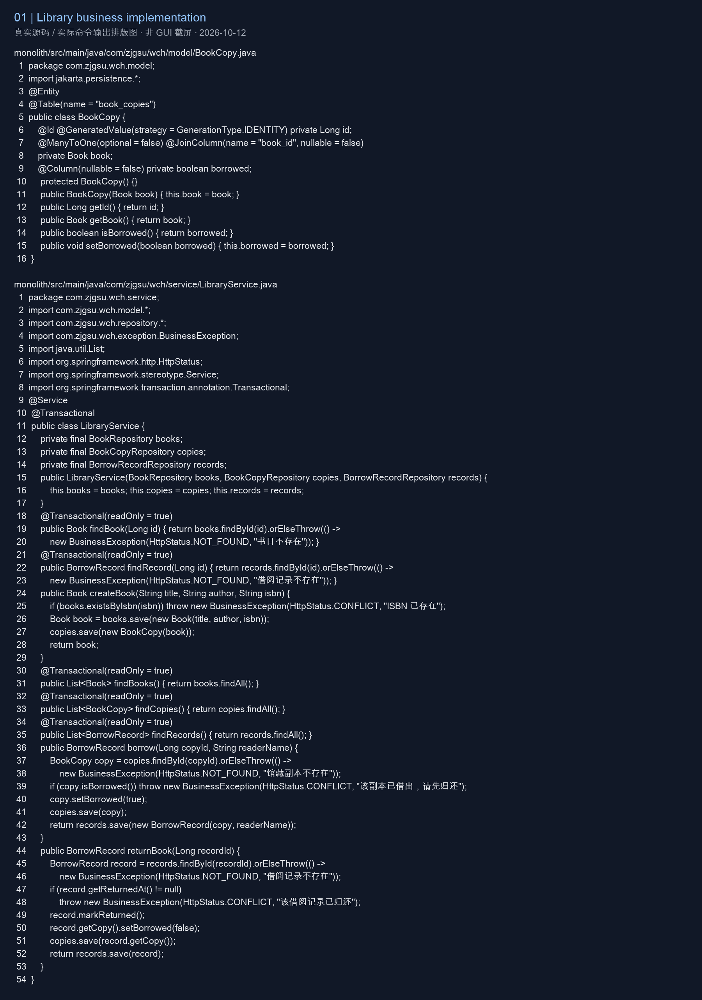
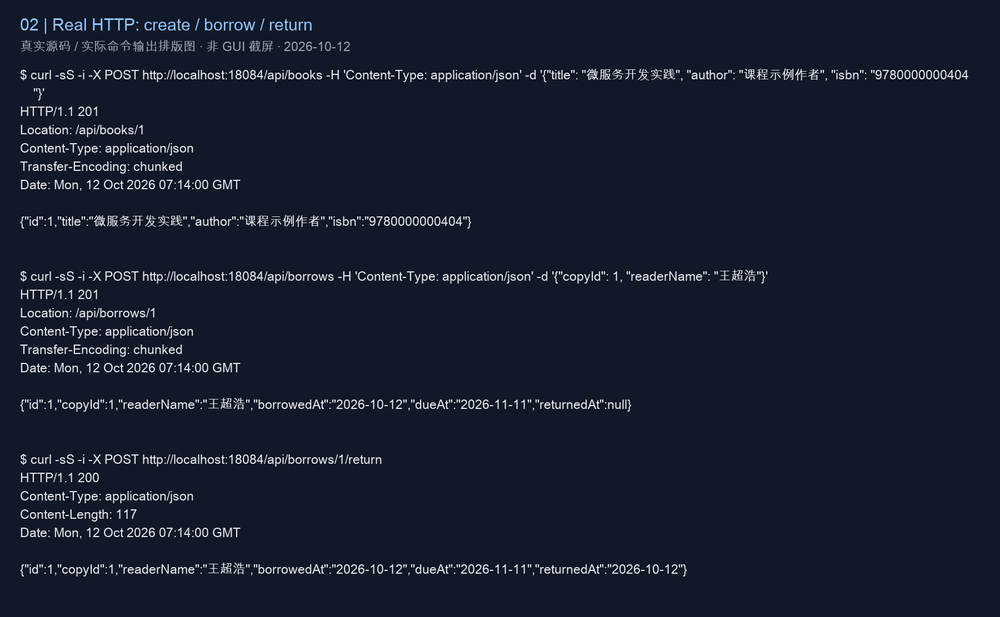
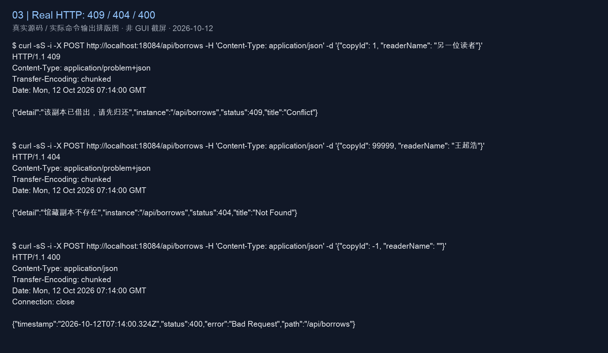
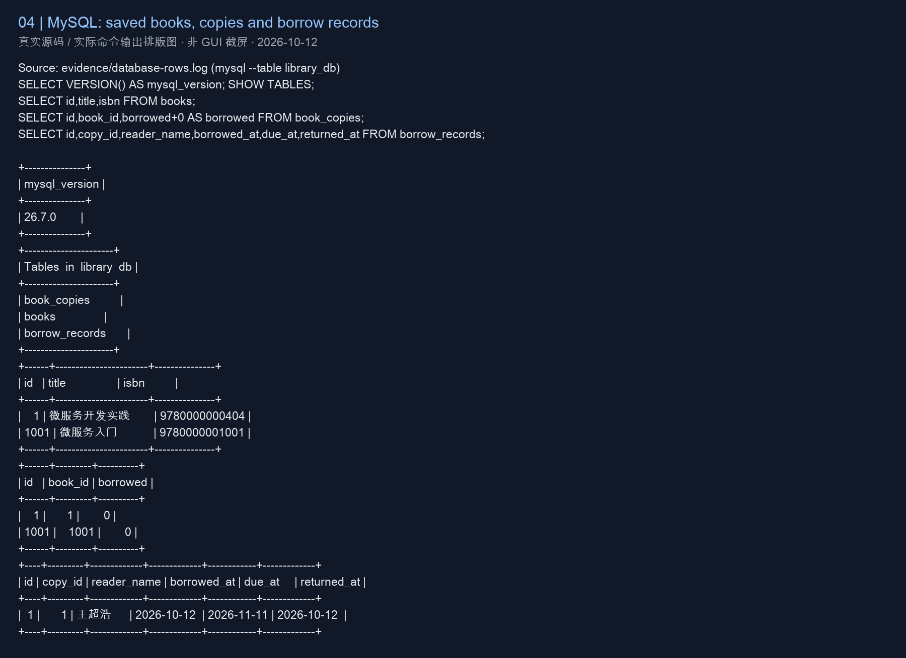
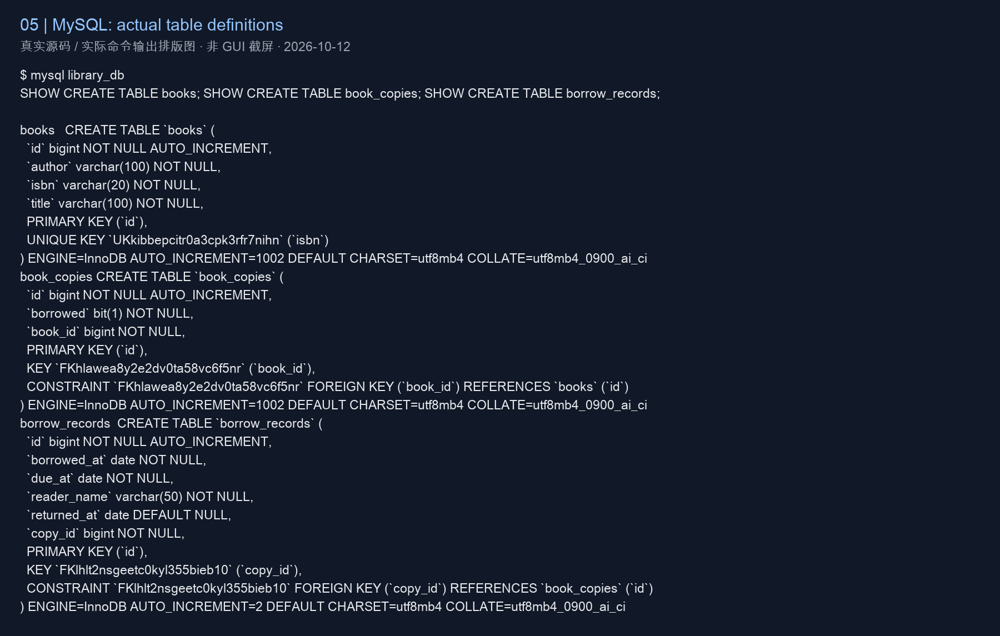
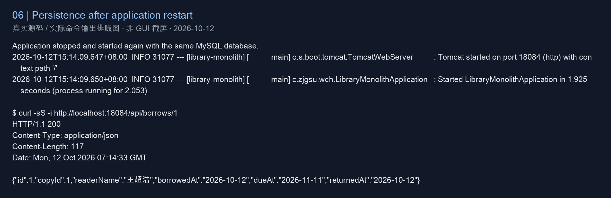
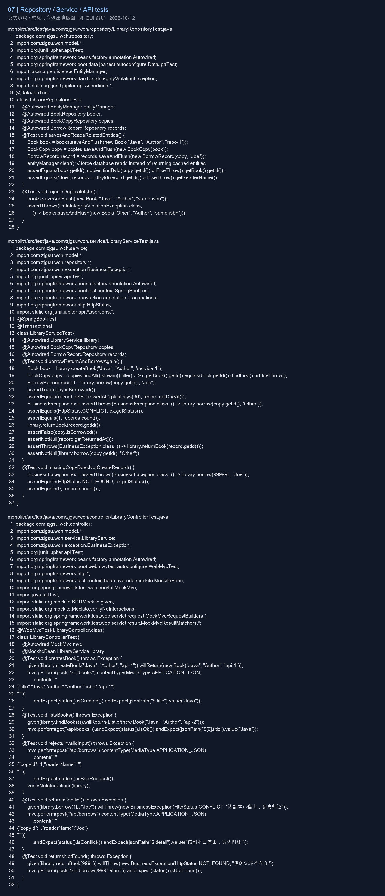
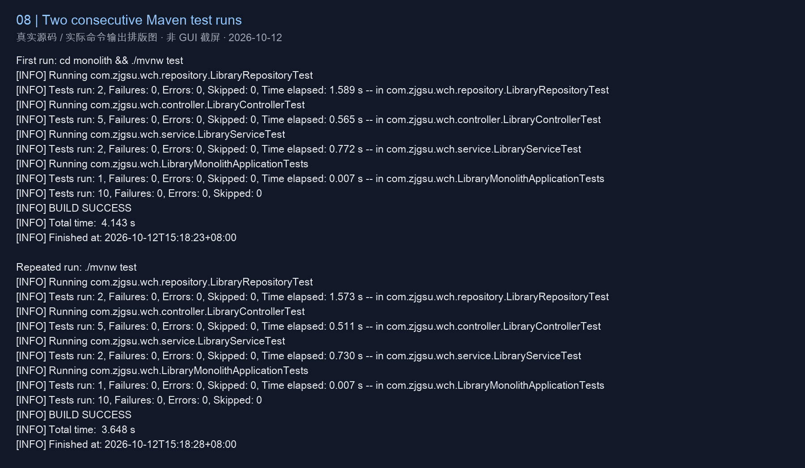

# 第四周：单体应用与数据库

沿用原公开仓库及 `monolith/`，包名 `com.zjgsu.wch`。验证日期：2026-10-12。

## 业务建模

实现查询书目/副本、借出、查询借阅记录和归还。Book 与 BookCopy 为一对多，BookCopy 与 BorrowRecord 为一对多。
Service 规则：已借出副本不能再次借出；已归还记录不能重复归还；借期 30 天。
创建书目自动建立一个副本，本周以姓名记录读者，不实现预约、罚款与身份账户。
详见 [选题文档](../../project-proposal.md) 与 [数据库设计](../../database.md)。

查看/验证命令：

```bash
cat docs/project-proposal.md
cat docs/database.md
```

结果：模型、关系、流程和规则与当前源码一致。

## 单体应用实现

新增 model、repository、service、controller、dto、exception。Controller 调用 Service，Service 通过 Repository 读写。
共有 8 个业务 REST 接口，包含列表、详情、创建、借出和归还，路径均以 `/api/` 开头。
启动与请求命令见根目录 README；本次隔离验证使用：

```bash
cd monolith
export JAVA_HOME=$(/usr/libexec/java_home -v 25)
DB_URL=jdbc:mysql://localhost:3307/library_db DB_USER=root SERVER_PORT=18084 ./mvnw spring-boot:run
curl -i http://localhost:18084/api/books
curl -i http://localhost:18084/api/borrows
```

结果：创建及借出返回 201、列表及归还返回 200、重复借出 409、不存在副本 404、非法输入 400。
完整实际请求及响应保存在 [api.log](evidence/api.log)。





## 数据库持久化

使用 Spring Data JPA 和 MySQL，实体映射到 books、book_copies、borrow_records，包含唯一 ISBN、非空字段与实际外键。
借出和归还在 Service 的事务中更新记录与副本状态。API 输入由 DTO 承载。
可重复准备数据：

```bash
mysql -u library -p library_db < monolith/scripts/init.sql
# 可重复导入同一脚本
```

本次使用本机已安装的 MySQL 26.7.0，独立临时实例端口 3307；推荐安装步骤写在 README，未声称验证过课程示例的 MySQL 8.4.x。
脚本连续导入两次后固定 ID 1001 仍只有一条。停止并重新启动应用，再次 GET /api/borrows/1 返回此前已归还的借阅记录，证明 MySQL 保存数据。
原始记录：[数据库行](evidence/database-rows.log)、[实际建表 DDL](evidence/database-ddl.log)、[重启查询](evidence/restart.log)。





## 测试与验证

```bash
cd monolith
export JAVA_HOME=$(/usr/libexec/java_home -v 25)
./mvnw test
./mvnw test
```

两次结果均为 Tests run: 10, Failures: 0, Errors: 0, Skipped: 0，BUILD SUCCESS。

- LibraryRepositoryTest：保存并读取三个关联实体；拒绝重复 ISBN。
- LibraryServiceTest：借出→拒绝重复借出→归还→再次借出；不存在副本不能生成记录。
- LibraryControllerTest：201 创建、200 查询、400 无效输入、409 业务冲突、404 不存在资源。
- LibraryMonolithApplicationTests：保留原有 contextLoads。

Repository/Service 测试使用 H2 与事务回滚自动准备/清理数据；API 测试使用 MockMvc 和模拟 Service，HTTP 层测试与 MySQL 实际请求证据分开记录。
原始 Maven 输出：[第一次](evidence/test-first.log)、[重复运行](evidence/test-repeat.log)。




## 图片来源

所有 PNG 由真实源文件或本次实际命令输出排版生成，图片注明来源，不是 IDE、终端或课堂现场截屏。原始日志同时保留，以便核对。
课堂座位与现场完成情况只能由学生本人确认；课内实践工程及材料在仓库外的 `提交材料04/课内实践/`。
