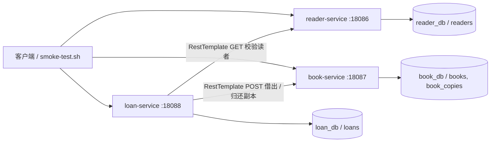

# 第六周：图书借阅系统微服务拆分设计

## 单体到服务的映射

保留 `monolith/` 的原有实现。在根目录 `services/` 新建三个独立 Maven/Spring Boot 工程，基础包均为 `com.zjgsu.wch` 的子包，不共享 Repository。

| 单体模块 | 新服务/包 | 主机端口（容器端口） | 数据库/账号 | 拥有表与职责 |
| --- | --- | --- | --- | --- |
| Book、BookCopy、书目创建与副本状态变更 | book-service / com.zjgsu.wch.book | 18087（8080） | book_db / book | books、book_copies；书目与实体馆藏副本管理 |
| BorrowRecord、借出与归还编排 | loan-service / com.zjgsu.wch.loan | 18088（8080） | loan_db / loan | loans；保存 readerId、copyId、借期和归还日期 |
| 原 readerName 字段及读者模块规划 | reader-service / com.zjgsu.wch.reader | 18086（8080） | reader_db / reader | readers；读者姓名和可用状态 |

读者服务是在单体按姓名借阅的基础上新增读者实体，不宣称原单体已有完整读者账户。旧库不做自动历史数据迁移，本周演示在三个新库中创建测试数据。预约、罚款、认证不在本周范围。

## 边界依据与数据所有权

图书服务将书目与馆藏副本放在同一边界内，因为创建书目同时新增副本，两者存在本地生命周期关系，可使用同库外键。借阅记录独立归借阅服务，跨服务仅保存 Long 类型的 readerId、copyId，不建立跨库外键，不直接读取其他库。每个服务使用单独 MySQL 容器、数据库及非 root 账号，只被授予本库权限。

三个工程均有自己的 pom.xml、src/、配置、Controller、Service 和测试，均提供 `/actuator/health`。根目录 compose.yaml 编排三个应用和三个数据库，每库独立命名卷。

## HTTP 调用与事务边界

1. 客户端在 reader-service 创建读者，在 book-service 创建书目及副本。
2. 请求 loan-service `POST /api/loans`，借阅服务使用 RestTemplate GET 读者并检查 active。
3. 使用 RestTemplate POST 图书副本 `/api/copies/{id}/borrow`。图书服务检查存在性和可借状态，提交自己的事务。
4. 远端成功后，借阅服务保存本地 loans，返回 201。
5. 归还时先调用图书服务 `/api/copies/{id}/return`，再更新 loans.returnedAt。

地址在 application.yml 中配置，通过 READER_SERVICE_URL、BOOK_SERVICE_URL 覆盖；连接超时 2000ms、读取超时 3000ms，均可通过环境变量覆盖。缺失资源返回 404，状态冲突返回 409，连接失败、超时或依赖 5xx 返回 503；不会捕获错误后跳过校验并继续写入本地记录。

远端修改副本成功、本地保存借阅失败时，可能出现副本已借出而无借阅记录的窗口。归还同样存在副本已释放、本地记录未归还的窗口；读取超时也可能发生远端已提交但响应丢失。`@Transactional` 只能回滚当前服务本地库，无法撤销已提交的 HTTP 操作。本周仅验证顺序流程和基本失败处理，不实现分布式原子事务、补偿或消息机制；也不宣称已解决并发抢借与重试幂等问题。

## 架构图

